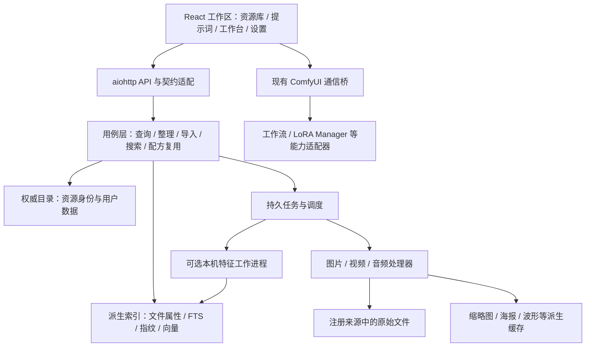

# ComfyUI Universal Extractor 架构评审与演进建议

评审日期：2026-10-15。代码基线：`98a58bf`，项目版本 `1.5.0`。

本文是改造建议，不代表已经实施。评审结合源码、隔离复现、现有自动化检查及官方技术资料；没有修改业务代码、运行真实 ComfyUI 工作流或操作用户图源。

## 1. 结论与适用场景

建议进行渐进式架构升级，保留 React / TypeScript / Vite、aiohttp 与 SQLite。当前最需要改的是资源身份、任务执行、领域边界和扩展契约。

用户当前数据约十几个 GB，存储在个人主机 SSD，主要单人使用，后续持续增长。该场景适合本地优先的模块化单体：安装入口仍是 ComfyUI 插件；媒体处理和搜索推理可按需交给本机独立工作进程。无需先引入远程数据库、Redis、分布式任务平台或完整插件市场。

容量不能直接换算为文件数或检索负载。下一轮应实际统计文件总数、目录数、分辨率分布、视频总时长、CPU/GPU 与可用内存，再决定批次、并发和索引实现。

产品定位建议：**面向 ComfyUI 创作流程的本地媒体资源库**。核心闭环是“生成 → 收集 → 找回 → 整理 → 复用配方”，图片、视频、音频、提示词和外部工具都服务于这条流程。

## 2. 适合保留的基础

- SQLite 分页、FTS、色系索引、schema 版本和损坏隔离已经存在；图库列表并非每次全量加载到 Python。
- JSON 用户状态与派生索引分离；状态文件采用锁、临时文件和原子替换，索引损坏不会直接覆盖收藏和笔记。
- 文件移动具备 staging、日志、冲突检查和保守回滚；已有异常注入测试。
- 前端已有虚拟瀑布流、懒加载、请求取消、来源隔离、双栏整理、统一确认和操作反馈。
- `recipe.py` 提供结构化生成配方，`UniversalPromptSnapshot` 已能保存解析后的文本；这是提示词复用的重要起点。
- ComfyUI 桥接有目标实例、协议能力检查、去重和执行结果验证；LoRA 定制不是完全耦合于页面点击的脚本。
- 项目已有后端、前端、桥接测试及构建产物审计，可以支撑小步迁移。

这些投入应转化为新架构的兼容约束与回归测试。单纯换 Web 框架或状态库，不会解决下面的数据和任务问题。

## 3. 代码发现：按改造紧迫度排列

此处“高优先级”表示下一轮开发应先处理，不代表每项都是安全漏洞。已复现的问题与对未来扩展的判断分别标注。

### 3.1 高优先级：上传异常时残留不完整文件〔已复现〕

位置：`py/gallery/routes.py:607`，尤其 `657–674`。

上传直接以最终文件名打开并同步写入。对大小和数量超限已有清理，但 `read_chunk()` 抛出连接异常、请求取消或磁盘写入异常时，没有覆盖整个接收过程的清理保护。当前文件完成前也未进入 `written_targets`。

隔离复现：第一块写入 13 字节，第二次读取抛出 `ConnectionResetError`；请求退出后最终路径仍存在，内容为 13 字节。复现使用临时目录和替换后的路径解析函数，不接触真实图库。这证明处理函数的异常分支存在缺口，不等同于已测试所有 aiohttp 断连模式。

影响：半成品以正常媒体后缀暴露给扫描器；大视频上传会放大残留空间与解析失败问题。同步磁盘写入也发生在 HTTP 事件循环中，慢写入可能拖延 ComfyUI 请求。

建议：上传进入同卷临时区，完成限额、文件类型与基本可读性检查后再提交最终名称；当前文件与同请求已写文件统一纳入异常清理；大文件写入移出事件循环并限制并发。对断连、取消、磁盘满及后续文件失败分别做测试。不要用全局清扫删除其他仍在进行中的上传。

### 3.2 高优先级：单一服务队列会让长任务挡住普通操作〔代码确认〕

位置：`py/gallery/execution.py:17`、`py/gallery/routes.py:306`、`387`、`431`；`py/gallery/service.py:3128`、`3348`。

大部分 API 通过同一个 `max_workers=1` 执行器；最多容纳 16 个运行或排队任务。变体分组 GET 会同步计算缺失指纹，包含文件 SHA-256、图片解码与元数据读取。缩略图等另有执行器，因此并非所有工作都被串行化。

影响：当前串行策略保护了写操作和事件循环，但一次慢磁盘扫描或指纹批处理仍可能挡住列表、备注、词库等服务请求。视频、音频和向量提取不能继续放进这条普通请求队列。

建议：保留文件变更的受控串行执行；普通查询使用独立、有限的读取通道；长分析交给持久任务。计算阶段不要长期持有数据库写事务。不要直接把全局线程数调大，绕过现有状态与文件锁。

### 3.3 高优先级：路径承担了资源主键职责〔代码确认，扩展风险〕

位置：`py/gallery/service.py:1146`、`1215`；`py/gallery/refs.py:20`；`py/gallery/state_store.py:81`、`172`；`gallery_ui/src/types/universal-gallery.ts:47`。

SQLite、JSON 状态、选择、缓存和指纹普遍以 `relative_path` 为关联依据。插件内移动会迁移状态，但外部重命名、源目录调整和重复文件会让“这是同一份资源吗”难以判断。

建议：增加持久 `asset_id`，把路径降为位置属性，内容指纹另存。资源身份注册表必须属于权威数据，重建派生索引不能重新分配全部 ID。内容相同的两个文件可以共享计算结果，但默认仍保留两份位置和各自注释，不能以相同哈希自动合并用户状态。

外部改名恢复采用明确证据；多个同哈希候选、跨来源副本、文件被原地替换等情况保留歧义，不自动套用收藏或笔记。

### 3.4 高优先级：图片模型贯穿所有层〔代码确认，扩展阻力〕

位置：`py/constants.py:23`、`py/gallery/source_security.py:100`、`py/gallery/metadata.py:17`；前端 `ImageRecord`、`ImageRecipe`、图片详情与卡片。

当前扫描、类型校验、预览、元数据和 API 都围绕 PNG/JPEG/WebP。新增扩展名不能自然得到视频时长、音轨、拖动播放、音频波形和生成信息。

建议：新增通用资产契约与媒体处理器。先让旧图片实现完整地通过新接口，再增加视频和音频处理器。避免在所有旧函数里不断添加 `if video`。

### 3.5 中高优先级：批量状态更新仍逐项完整保存 JSON〔已复现〕

位置：`py/gallery/service.py:4707`；`py/gallery/state_store.py:172–199`。

`batch_update_images()` 循环调用 `update_image_state()`，每次都会保存整个状态文件。隔离调用 20 条批量备注更新，记录到 20 次完整状态保存。已有 SQLite 增量同步优化不消除这一写入成本。

建议：先实现一次加锁、一次读取、内存批量修改、一次原子保存，且保留实际成功/失败的逐项结果。该修复可独立交付，无需先迁移数据库。以后再评估是否把用户注释与关联表迁入权威目录库。

### 3.6 中高优先级：现有变体分析不能承担全库以图搜图〔代码确认〕

位置：`py/gallery/service.py:118`、`3034`、`3348`、`3404`；`py/gallery/variant_fingerprints.py:68`。

变体候选受 `VARIANT_GROUP_SCAN_LIMIT=2000` 限制；默认按排序选取有限范围。返回值已有扫描上限说明，应保留。分组详情还会先跑一遍分组，再读取并重建分组。dHash 用于近重复，不是语义特征。

建议：重复整理与检索分成两个用例。检索直接查询全库已建好的指纹或向量索引，返回覆盖率、匹配类别、相似分数与实际位置；分组详情复用分析结果或按分组键查询，避免重复计算。

### 3.7 中优先级：freshness 的持续全范围 stat 成本仍随文件数增长〔代码确认〕

位置：`py/gallery/service.py:2685`；`gallery_ui/src/hooks/useGalleryData.ts:15`。

可见页面约每 6 秒检查一次，后端遍历当前范围、读取文件 stat 并计算指纹。当前已有短缓存、范围上限及关闭开关，性能比全量重建好，但成本仍近似随范围文件数增长。

建议：ComfyUI 已完成输出事件作为快速提示；外部写入使用可选目录监听；启动、事件丢失及低频定时对账负责最终一致性。监听事件也不能直接代表文件已写完，需检查文件稳定性。继续保留手动刷新和无监听时的轮询降级。

### 3.8 中优先级：领域职责集中，前端扩展容易互相影响〔代码确认〕

物理行数：`service.py` 4720 行、`GalleryWorkspace.tsx` 1790 行、`App.tsx` 1218 行、`WorkbenchWorkspace.tsx` 1011 行、`useGalleryData.ts` 938 行。

问题并非行数本身，而是图源、索引、文件操作、词库、生成、选择、变体和导航共处较少的中心模块。前后端类型依赖手工一致，TypeScript 配置未启用 `strict`。工作台的工具集合和入口列表也直接定义在组件中。

建议：先抽领域用例与仓储边界，保留旧 facade；前端按资产查询、选区、文件操作、变体、配方、工作台工具分离。为新契约生成或验证 TS 类型；分模块收紧类型检查。是否引入查询缓存库，等状态职责拆清后再定。

### 3.9 发布前处理：依赖审计失败〔工具确认〕

本次 `npm run audit:security` 非零退出。`npm audit` 标出 3 个带 high 级公告的间接依赖包：

| 包 | 当前锁定版本 | 本地依赖链示例 |
| --- | --- | --- |
| `brace-expansion` | `1.1.18`、`5.0.9` | ESLint / TypeScript ESLint → minimatch |
| `source-map-js` | `1.2.1` | Tailwind Node / PostCSS / jsdom |
| `undici` | `7.29.0` | jsdom |

这是依赖包计数，不是恰好三个独立漏洞。`--omit=dev` 后仍报告一个包，与 Tailwind 构建工具被列在 dependencies 中有关。不能据此直接断言生产浏览器或 ComfyUI 后端可被这些公告利用。

建议独立补丁更新兼容的间接依赖并完整验证，必要时调整构建依赖分类；避免未经验证执行强制跨主版本修复。本次未修改锁文件。

公告：[brace-expansion](https://github.com/advisories/GHSA-qhr7-859c-m2p7)、[source-map-js](https://github.com/advisories/GHSA-68fv-2mgg-jv7q)、[undici](https://github.com/advisories/GHSA-rfgv-xxqx-mfg5)。

### 3.10 工程跟进项

- `created_at` 多处直接使用 `st_ctime`；跨平台应区分文件系统时间、首次发现时间与生成时间。默认排序加入稳定的 ID 次序，减少相同秒级时间导致的分页不确定性。
- `recipe` 已有 `multiple_samplers` / `prompt_unresolved` 警告，应继续补来源节点、提取器版本、字段出处，避免多输出工作流把配方绑定错对象。
- 工作台 localStorage 有异常保护，但仍直接调用浏览器存储；后续按现有 `safeStorage` 约定统一处理与验证持久枚举。
- 真实 LoRA Manager 集成测试是可选的，本机缺少上游源码而跳过；应明确测试过的上游版本并在兼容性任务中实际执行。
- 十几个 GB 的真实图库冷启动、混合媒体、Windows 文件占用、长路径和睡眠恢复尚无本次实测结论。现有测试通过不代表这些场景已覆盖。

## 4. 建议目标架构

建议领域：`assets`、`sources`、`catalog`、`indexing`、`file_ops`、`media`、`search`、`prompts`、`integrations`、`jobs`。这是职责划分，可分批落到现有 `py/gallery` 中，不必第一步搬迁整个目录。

`service.py` 暂时保留旧导出，转发到新用例，降低路由、测试和第三方兼容的迁移成本。ComfyUI 路由仍由原入口注册。核心服务逐步通过注入的路径/宿主接口获取环境，避免在领域代码里依赖 ComfyUI 全局对象。

### 4.1 资产身份与存储

建议最小资产模型：

| 字段 | 含义 |
| --- | --- |
| `asset_id` | 持久资源 ID，插件内改名移动不改变 |
| `media_type` | `image` / `video` / `audio`，前端使用判别联合类型 |
| `source_id`、`relative_path` | 当前所在位置，按来源规范化路径唯一 |
| `availability` | online / missing / trashed 等状态，离线不能当作已删除 |
| `observed_size`、`mtime_ns` | 快速变更探测依据，不能充当严格内容身份 |
| `content_revision` | 原地修改后的处理版本，用来拒收过期任务结果 |
| `content_sha256` | 可延迟计算，供精确去重和缓存复用 |
| `first_seen_at`、`file_modified_at`、`generated_at` | 不同语义的时间，允许未知 |
| `metadata_status`、`preview_status` | 分析进度与失败状态，不阻止资源被列出 |

第一版每个实际文件位置对应一个资源实例；只有确有多位置协同需求时再抽 `asset_locations`。不要为了未来可能出现的复杂场景先做庞大领域模型。

为权威数据与派生数据设独立边界。可新增 `catalog.sqlite3` 保存身份与未来用户关系；原 `gallery_index.sqlite3` 继续可删除重建。**不能把资源 ID 和用户数据直接塞进现有可自动隔离重建的索引库，然后继续沿用“损坏就全部重建”的处理。**

近期 JSON 用户状态继续作为权威。以后迁移注释、收藏、图版、提示词关系时，先有备份、schema 迁移、逐项核对和回滚路径，再一次性切换权威来源；不长期维持两个并列可写的真相来源。JSON 词库仍保留文件导入导出能力及节点兼容。

SQLite 和缓存留在主机本地 SSD。若未来原始媒体放 NAS，也不应顺带把 WAL 数据库放共享盘；WAL 要求相关进程位于同一主机。[SQLite 官方说明](https://www.sqlite.org/wal.html)

### 4.2 媒体处理器

定义小接口：`probe`、`extract_metadata`、`build_preview`、`build_search_features`。统一返回类型和状态，按能力决定前端操作；视频和音频无需伪装成图片。

- 图片：复用 Pillow 安全解码、缩略图、色板与现有 recipe。
- 视频：先读取时长、尺寸、编码、帧率与音轨；生成海报；支持浏览器播放和 Range 请求。浏览器不能解码的文件仍可收录，兼容预览转码作为可选任务。
- 音频：读取时长、编码、采样率与声道；生成紧凑波形数据；支持播放和跳转。
- 原文件、同名工作流/配方 sidecar、海报与派生帧应有明确关系；是否联动移动由规则和预览决定，不能随意把同名前缀全部搬走。

`ffprobe` 支持结构化 JSON 流与容器信息，可作为视频音频探测基础；衍生预览交给 FFmpeg。[官方文档](https://ffmpeg.org/ffprobe.html)

调用只传已解析的注册来源路径，用参数数组而非 shell 拼接，限定超时和输出量。缺少 FFmpeg 时显示能力缺失，普通图片管理继续可用。不要默认转码全部视频。

### 4.3 持久任务

先实现本机任务表即可：任务种类、资源 ID、内容版本、处理器版本、状态、进度、重试时间、错误、租约/心跳。去重键至少包含 `(asset_id, content_revision, task_type, processor_version)`。

任务类型包括扫描、metadata、海报、波形、文件哈希、视觉向量。分开设置磁盘/CPU/GPU 并发与优先级，用户正在看的资源优先。请求返回任务 ID，进度进入现有状态中心；浏览器关闭后工作状态仍可恢复。

文件变更保留现有日志协议及锁。取消分析可在安全点停止，取消 HTTP 不得打断已开始的文件提交。重试必须幂等，进程重启后区分可安全重试与需要人工恢复的文件事务。

重模型依赖放可选本机工作进程与独立环境，避免导入图库就加载模型或更改 ComfyUI 的 Torch/CUDA 依赖。CPU 可运行，GPU 由用户开启；后台批量建库要能暂停，避免抢占跑图显存。

## 5. 以图搜图：围绕“找到文件位置”实现

### 5.1 三种匹配分别呈现

| 用户需求 | 建议方法 | 产品说明 |
| --- | --- | --- |
| 找同一个文件 | SHA-256 | 字节完全一致；元数据变更后文件哈希可能不同 |
| 找缩放、压缩、轻微修改的版本 | 现有 dHash 作基线，评估 pHash / 标准化像素摘要 | 近重复，不承诺任意裁剪或截图都能命中 |
| 找相似主体、内容、构图或风格 | 图像 embedding + 向量近邻 | 相似结果，不能当作同一张图的证明 |

第一版沿用现有指纹补一个真正的全库检索入口，随后加入一个 embedding 模型。不要让“必须先下载大模型”成为找原图的前置条件。

### 5.2 完整交互

入口支持：现有资源“找相似”、拖入查询图、粘贴查询图。上传的查询样本默认临时使用，不自动导入词库或图源。

返回每个命中的预览、匹配种类、原始分数、来源名、相对路径、可复制的主机绝对路径、当前是否存在。点击可定位图库目录、打开详情、查看生成配方。查询时默认排除自身；同内容副本可展开显示全部路径。

“在资源管理器中显示”属于本机显式操作，通过受限本机能力按 `asset_id` 重新解析，不能让浏览器提交任意路径后直接执行。以后远程访问时，需要标明路径属于服务器。

搜索结果明确显示“已索引 N / 总计 M”和建库状态。预筛选或足量候选重排必须真正满足 source、类型和删除状态约束，不能先固定取少量全库候选再过滤，导致明明有结果却返回空。

### 5.3 模型与向量引擎选择

OpenCLIP 已提供图像/文本编码及归一化特征接口，适合建立首个可比较基线；具体权重对中文、二次元、风格和裁剪的表现必须用本图库测试。[官方项目](https://github.com/mlfoundations/open_clip)

可把 SigLIP2 或 DINOv3 作为后续对照实验，分别评估跨模态和视觉特征用途；不要因为模型更大或更新就默认替换。[SigLIP2 文档](https://github.com/huggingface/transformers/blob/main/docs/source/en/model_doc/siglip2.md)、[DINOv3 官方实现](https://github.com/facebookresearch/dinov3)

模型许可、下载方式、预处理、权重校验和必须随具体权重确认。持久记录模型 ID、权重版本/摘要、预处理版本、向量维度与归一化约定；不同向量空间不能混搜，升级时允许后台重建后切换。

向量层先定义 `upsert / delete / search / rebuild` 接口。个人图库可先采用归一化 float32 矩阵和精确搜索，建立延迟、内存及召回基线；超出目标后再选经过 Windows 安装验证的本地近邻索引。Faiss 可列入候选，但其官方安装路径和 GPU 平台限制需要先核实。[Faiss 入门](https://github.com/facebookresearch/faiss/wiki/Getting-started)、[安装说明](https://github.com/facebookresearch/faiss/blob/main/INSTALL.md)

例如 10 万条 512 维 float32 向量本体约 195 MiB，另有映射、索引、模型和处理内存。这只是容量估算，不是当前图库规模或性能测量。初期不需要启动独立向量数据库服务。

### 5.4 验证效果

从自有图库挑选至少 100 个查询案例，涵盖原文件、压缩、改尺寸、裁剪、截图、同主体不同图、同风格不同主体。分别标注“原图找回”和“内容相似”的期望结果。

记录 Recall@1/5/20、P50/P95 查询时间、建库速度、内存和显存峰值；ANN 结果对照精确检索评估召回。界面分数不是匹配概率，不标注未经校准的“95% 是原图”。视频搜帧放在第二阶段，以命中帧时间点回到原视频。

## 6. 提示词管理：从词条编辑升级为可复用资产

保留 JSON 库和 Randomizer 的兼容输入，逐步区分三类对象：词条/片段、可组合模板、某次生成的已解析文本快照。

建议支持标签、用途、语言、适用模型、版本、来源与备注；组合结果能保存为版本，而非只有当前文本框。生成快照关联资源、配方和当时的模板版本；不能通过重新执行随机节点去猜测历史图片提示词。

继续消费 `recipe` 契约，补 `schema_version`、提取器版本与字段出处。手动整理的提示词独立保存，不覆盖嵌入式原始 metadata；配方不完整时明确显示未知。为 LoRA、checkpoint 等保留“原始引用名”和未来可解析的资源引用，不急于建立全量模型资产库。

近期可交付闭环：图片详情 → 收藏提示词/配方 → 提示词库搜索 → 复制或显式应用到 ComfyUI。之后再加模板组合与参数化编辑。

## 7. 外部项目入口与定制集成

把“打开一个项目入口”和“修改 ComfyUI 图”分成两个能力层。

### 7.1 工具入口

利用现有工作台工具栏和 inspiration 入口，增加小型注册表：`id`、名称、分类、简介、URL、图标、标签、打开方式。内置条目与用户自定义条目分开，升级不覆盖个人收藏。

先支持外部链接和本机 Web 服务 URL；URL 允许规则明确，外部页优先新标签打开，嵌入只在目标允许且确有体验收益时使用。默认不扫描端口、不自动启动其他项目、不抓取任意地址的网页内容。该层不需要可执行的第三方插件系统。

### 7.2 ComfyUI 集成适配器

保留 `BroadcastChannel` 单目标通信；把 LoRA Manager 的检测、格式转换、节点写入与验证抽为独立适配器，而不是继续扩大 `top_menu_extension.js` 的条件分支。

每项动作声明能力版本、可用性、目标选择、变更预览、确认和结果格式。前端展示“当前页面支持哪些操作”，解析器从配方生成适配输入。Append/Replace、独立 CLIP=0、折叠状态、回调延迟、重复消息、失败恢复都作为必须保留的契约测试。

第三方改版时只替换适配器与测试基线。需要验证上游真实版本；单靠模拟节点测试不能覆盖上游回调变化。暂不增加任意脚本加载、自动安装插件或通用图重写 DSL。

## 8. 实施顺序与可独立验收的交付

| 阶段 | 交付内容 | 验收重点 |
| --- | --- | --- |
| A：修复与基线 | 上传临时提交/异常清理、批量一次保存、依赖补丁、真实图库统计与性能记录 | 断连无残留；批量一次保存；现有检查通过；审计通过 |
| B：核心解耦 | 资源身份注册、Asset 契约、图片处理器、文件操作/索引/词库用例拆分 | 图片行为不退化；移动 ID 稳定；重建索引不丢身份/状态；旧 API 可用 |
| C：找回资源 | 全库原图/近重复检索，随后 embedding 任务和相似检索 | 返回具体路径；覆盖率透明；模型可关闭；明确召回与性能数据 |
| D：视频音频 | 探测、海报/波形、播放、元数据 sidecar、混合列表与任务恢复 | 大文件不拖慢图库；不支持的编码可收录；可选依赖缺失时降级 |
| E：复用与扩展 | 提示词/配方收藏与版本、工具入口注册、LoRA 适配器 | 从资源到配方到 ComfyUI 闭环；现有定制行为保持 |

提示词收藏和工具入口是独立的小增量，可在 B/C 期间穿插；不要让它们阻塞核心改造。默认优先完成 C，因为“找到文件及复用”最贴合当前图片管理用途。若视频已是近期主要产出，可将 C 的 embedding 部分与 D 交换，B 的资产与任务边界仍先落地。

每阶段形成若干小 PR，禁止把模型接入、数据迁移、UI 重做和文件事务修改放在一个难以回滚的大提交里。版本号在实现范围确定后再定，不预先承诺固定工期。

### 第一批建议提交

1. 修复导入异常清理和同步写入边界，增加针对断连/磁盘失败的测试。
2. 批量状态更新一次保存，确认部分失败反馈与原语义一致。
3. 更新可兼容的间接依赖并跑完整验证，单独记录公告处置。
4. 记录真实来源统计与冷/热列表、freshness、批量更新、分析并发时延迟；只用隔离或用户指定的只读来源采样。
5. 提交资产身份与任务协议的设计决策，再以图片实现作兼容迁移。

## 9. 数据迁移与回归要求

- 任何迁移先备份 `gallery_state.json`、来源配置、词库和新增权威目录，核对条目数、收藏/图版关系、笔记与重复路径。
- 首次登记身份以现有来源与路径映射为准；默认 output 的旧无前缀 ref 继续作为别名支持，不能借重构改掉旧状态键。
- 老 API 暂时保留，通过适配器映射 ID 与旧路径。新增媒体 API 可先放 `/api/v2/assets`，避免把全部旧调用一次替换。
- 新旧读取结果可做只读对比；正式切换写入要有唯一权威。回滚必须能解释新版本期间发生的编辑，不能只恢复一份旧快照丢弃新数据。
- 保留图库首屏索引复用、非图库不请求图片、图源隔离、懒加载、虚拟框选、Inspector 让位、双栏退出重测等行为。
- 用户操作结果按实际已提交项反馈；资源已移动或删除时，旧分析任务结果不能覆盖新版本。
- 后续基准覆盖图片数量增长、单个超大媒体、深目录、损坏文件、Windows 占用与服务重启。性能预算由本机基线决定，任何目标值都与实测分开记录。

## 10. 本次验证结果与限制

| 检查 | 结果 |
| --- | --- |
| `python -m pytest -q` | 108 passed |
| `node --test tests/comfy_lora_stack_bridge.test.mjs` | 11 passed |
| `node --test tests/comfy_lora_manager_upstream.test.mjs` | 6 skipped，本机无上游源码 |
| 前端 `npm run test:run` | 35 个文件、204 项测试通过 |
| 前端 `npm run typecheck`、`npm run lint` | 通过 |
| 前端 `npm run audit:i18n` | 893 个 key 检查通过 |
| 前端 `npm run audit:dist` | 已提交 dist 的 23 个引用检查通过 |
| `python scripts/check_release.py` | 版本 1.5.0 元数据一致 |
| 前端 `npm run audit:security` | 失败：3 个受影响包，详见 3.9 |
| 隔离复现 | 上传异常残留成立；20 条批量状态更新触发 20 次保存 |

为运行前端检查，按现有 lockfile 安装了被忽略的 `gallery_ui/node_modules`；未变更 manifest 或 lockfile。Python 使用本机可用的 Python 3.12，交接说明指定的 D 盘解释器本机不存在。

本次没有重新生成生产 dist，没有执行真实 ComfyUI/GPU、浏览器完整流程、视频转码或真实图库性能测试。完整发布验证不能判为通过，原因是依赖审计失败，且本次不是完整 `verify.ps1` 流程。下一步实施前保留这份测试结果作为静态评审基线，新增功能仍需相应集成验证。

## 11. 当前不建议优先投入的改造

- 因“项目旧”而迁移 React、aiohttp 或 SQLite；当前前端依赖版本已经较新。
- 微服务、消息中间件、容器集群、多人权限和独立向量数据库；目前个人主机场景没有对应收益证据。
- 一次性把全部 JSON 状态迁进现有可重建索引库。
- 所有媒体默认完整哈希、自动转码、自动下载模型或自动占用 GPU。
- 任意执行脚本的插件市场，以及自动管理外部项目进程。
- 在未验证搜索效果前投入复杂“智能打标”、自动删重或自动归档。

当前最有价值的结构变化是：**稳定资源身份 + 媒体处理接口 + 有界持久任务 + 可替换检索与集成适配器**。这些边界建立后，后续功能可以独立增加，同时保护已经可用的图片管理体验。
