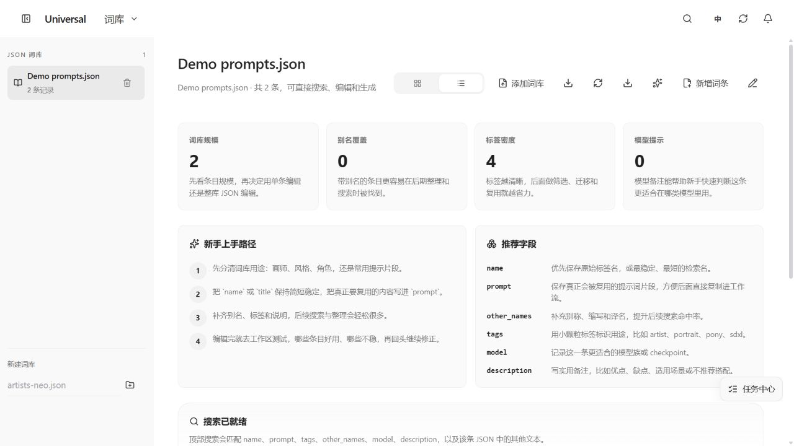
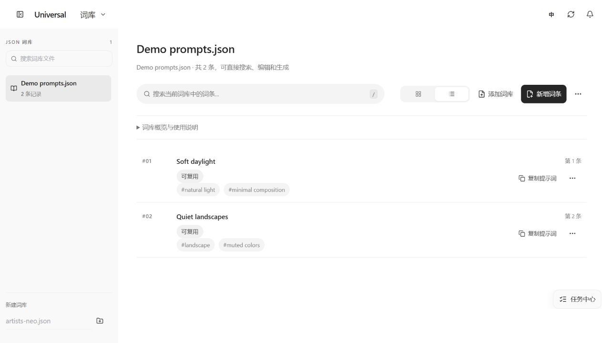
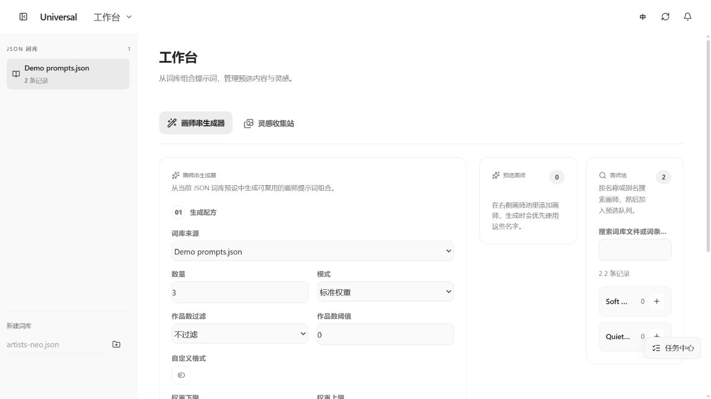
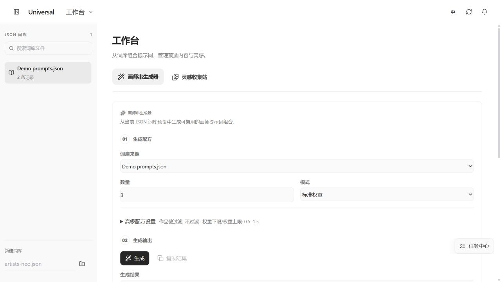

# UI/UX 对齐评审与本地候选 1.8.1

基准为用户确认的图库界面：白色内容区、浅灰资源导航、简洁标题、圆角搜索框、轻量工具栏、内容优先、单行元信息。此轮保留图库几何、选择机制、任务监听、自动同步、文件事务和 ComfyUI/LoRA 桥接。

## 发现与处理

| 页面/组件 | 原有问题 | 对齐方式 |
| --- | --- | --- |
| 词库 | 首屏四张统计卡、两组教学说明和搜索说明先于条目；搜索藏在右上角，与图库操作路径不同 | 标题、页内搜索和操作、条目优先；概览与教程放入默认折叠的说明，保留全部内容 |
| 词库操作 | 多个常驻小图标层级相同，导入/导出图标相似，删除与常用复制混在一起 | 保留添加文件和新增词条；导出、模板、整库编辑移入更多菜单；条目保留文字复制入口，管理动作进入更多 |
| 词库状态 | 搜索无结果也提示“词库为空” | 分别显示空词库与无匹配，提供新增或清空搜索；IME 输入及 `/`、Ctrl/⌘+K 与图库一致 |
| 工作台 | 后加样式覆盖 1320px 断点，导致生成区、预选和画师池同时挤在首行 | 恢复断点下的宽生成区；辅助面板移到下方，小屏继续单列 |
| 工作台操作 | 全部配方字段占用首屏；预选按钮使用“创建”，满额/已选时重复点击没有变化 | 高级配方按需展开并显示当前有效摘要；明确“加入预选/已加入/最多20位”，已选或满额时禁用 |
| 灵感站 | 独立强调色、卡片渐变和层层面板容易脱离工具界面 | 保持工具架结构，使用统一灰阶、细边框与静态表面；外站内容与链接语义不变 |
| 设置 | 不请求词库时侧栏却显示“没有可用词库”，还保留创建入口 | 换成浏览偏好、图片目录、诊断导航；不额外请求词库或图片分页 |
| 设置控件 | 通用主/次按钮的完整布局藏在 settings.css；先打开设置可能改变其他页面按钮 | 通用动作样式移到首屏 base.css，特性样式只负责本工作区 |
| Metadata | 直接从右键进入时没有加载 detail.css，独立弹窗可能缺少布局和字段样式 | 提取共享 metadata.css，由 Metadata 和图片详情分别显式引用，保持按需加载 |
| 普通弹窗 | 分类、图版、导入、词条编辑和文本输入缺少统一键盘焦点与 Escape 关闭 | 共用 ModalSurface 和 interaction.ts 的焦点工具，返回触发位置；嵌套确认优先处理键盘 |
| 词条草稿 | 点击遮罩或关闭可直接丢失修改 | 关闭时检查草稿，显式放弃后才退出；提交中禁用关闭与编辑 |
| 以图搜图 | 紫色悬停、匹配标签与主界面灰阶不同 | 使用共享灰阶和字号；精确匹配的绿色作为有含义的状态保留 |
| 垃圾箱、双栏、变体 | 辅助卡片边框、选中和元信息存在不同强调方式 | 对齐轻量表面、灰阶选中与字号；保留垃圾箱独立工具栏、预览固定比例和危险操作红色 |
| 图片详情 | 沉浸模式需要不同亮度，但部分重试与选中控件使用紫色 | 保留深色看图；动作改为中性高对比，元数据使用白色/浅灰阅读面板 |
| 全局 | 设计变量在 base/minimal/motion/app shell 多处重定义；弹层不在 app shell 内时无法继承部分规则 | 全局变量统一到 base.css；整理现有 workspace-system.css 而非新增临时覆盖层；确认层高于普通弹窗 |

## 固定规范

- 正文约 14px，控件 13px，重要元信息至少 12px；紧凑模式仍只压缩间距，不缩小正文。
- 页面标题约 23px，弹窗标题约 20px，模块标题约 16px；使用空白和分隔线，而非大色块或装饰性渐变区分结构。
- 搜索属于当前工作区；主要操作有文字，次要操作可展开。禁用和状态色表达实际意义。
- 所有共享按钮、全局颜色和层级不依赖访问顺序；独立可打开的懒加载页面必须拥有自身需要的 CSS。
- 普通弹窗遵循同一焦点和返回规则；确认框保持最高层。危险确认和草稿保护不因视觉简化而删除。
- 不把浅色工具界面强行套到沉浸看图或导出的图版画布上；不改图片、卡片比例和瀑布流位置算法。

## 验证记录

针对隔离示例服务运行浏览器检查，不使用真实图源修改操作。截图使用程序生成图片与示例词库，不包含用户截图中的原图。源码审查覆盖表中各页面；浏览器重点实测图库、垃圾箱、双栏、变体、词库有数据/无结果/编辑、工作台预选/高级配方、设置、图片详情、直接 Metadata 与以图搜图。空词库、导入与普通弹窗边界另由组件测试覆盖。

五个主页面分别在 390、768、960、1280、1440、1920px 的标准及紧凑模式完成 DOM 几何检查，共 60 种组合，未发现页面或主滚动区域横向溢出。代表性截图人工检查覆盖手机词库/工作台与桌面五页、Metadata、深色详情、双栏及变体；几何测量不等同于逐一截图目检。原始截图工具在模拟视口下存在缩放/加载中截图，只有 `*-final.png`、重新捕获的手机词库/工作台截图及下方文档图片作为视觉验收证据。

- Python 171 项、前端 266 项、LoRA 桥接 11 项、工作流完成桥接 2 项通过；固定上游 LoRA Manager 集成 6 项通过。
- 类型、lint、中英文键检查、安全审计、构建、29 项 dist 引用审计与 1.8.1 发布元数据校验通过。没有删除或跳过旧行为测试。
- 词库无结果不会隐藏侧栏文件；条目管理位于更多菜单。草稿 Escape → 取消保留内容和焦点，再次 Escape → 放弃正常关闭并返回入口。
- 普通弹窗层级 240、嵌套确认层级 300。独立 Metadata 只加载自身共享样式，无需先加载图片详情。
- 以图搜图连续三次打开，分别通过关闭按钮和 Escape 退出后仍可重开；图片详情保持深色背景。
- 工作台预选成功后对应按钮禁用，高级配方可展开；双栏、变体切换及退出后普通浏览正常。

验证记录：`artifacts/ui-alignment-release-verify.log`、`artifacts/ui-alignment/layout-metrics.json`。浏览器和桌面检查基于隔离示例，不替代真实 ComfyUI 工作流联调或大图库性能测试；本轮未修改这些后端链路。真实插件安装仍为此前部署的 1.8.0，此次不会在运行中替换或自动发布。

## 前后对照

同为 1280×720 的示例窗口。词库将操作和内容提前，工作台恢复可用的宽生成区。

词库调整前：

词库调整后：

工作台调整前：

工作台调整后：

